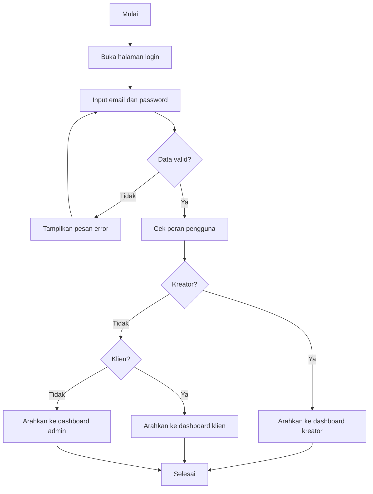
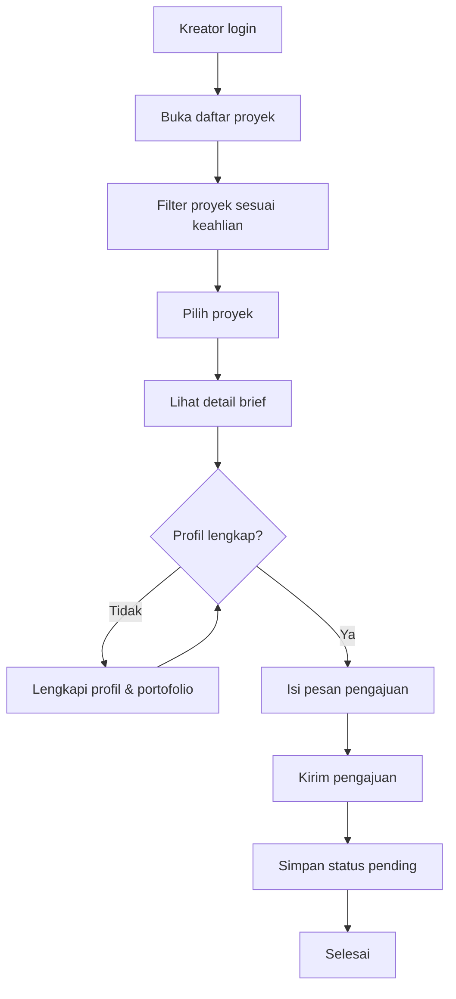
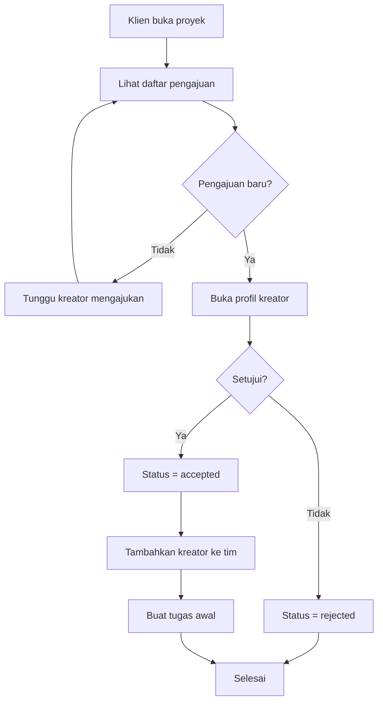
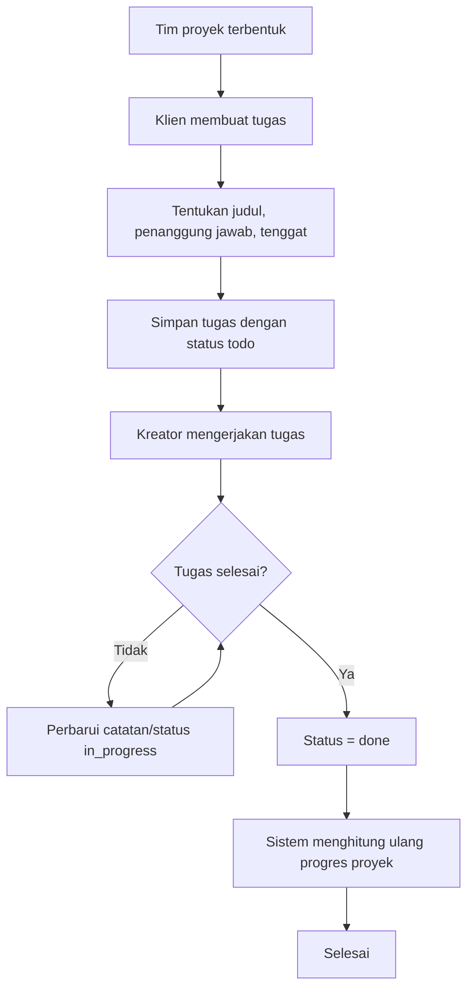
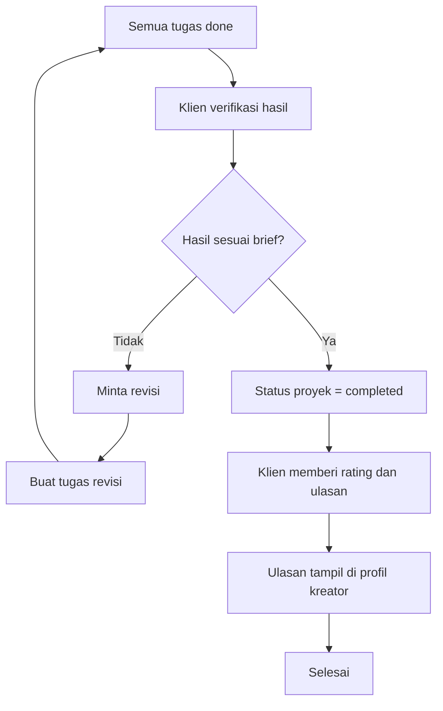

# Activity Diagram

## 1. Tujuan

Activity diagram digunakan untuk menggambarkan alur kerja sistem KreaChallenge, termasuk percabangan keputusan, proses parallel, dan kondisi akhir. Dokumen ini melengkapi use case dengan memperlihatkan urutan aktivitas.

## 2. Aktivitas Autentikasi

## 3. Aktivitas Pengajuan Kreator

## 4. Aktivitas Seleksi Pengajuan oleh Klien

## 5. Aktivitas Manajemen Tugas

## 6. Aktivitas Penyelesaian Proyek

## 7. Catatan Pemodelan

1. Simbol `{}` pada diagram Mermaid merepresentasikan keputusan/percabangan.
2. Setiap alur memiliki kondisi awal dan akhir yang jelas.
3. Alur alternatif ditampilkan untuk kondisi profil belum lengkap dan hasil tidak sesuai.
4. Activity diagram ini selaras dengan use case UC-01 sampai UC-13.

## 8. Kesimpulan

Activity diagram KreaChallenge menggambarkan lima alur utama: autentikasi, pengajuan, seleksi, manajemen tugas, dan penyelesaian proyek. Alur-alur ini menjadi dasar pembuatan logika bisnis pada lapisan backend.
