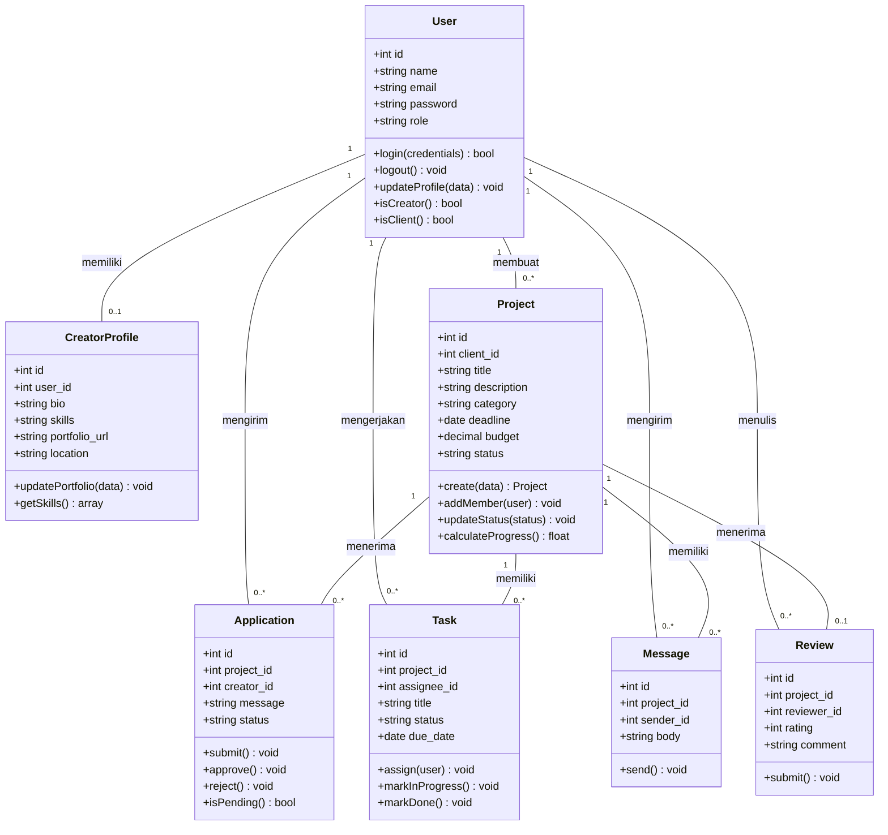

# Class Diagram

## 1. Tujuan

Class diagram menggambarkan struktur objek dalam sistem KreaChallenge, meliputi kelas, atribut, metode, dan hubungan antarkelas. Diagram ini membantu pengembang memetakan model Eloquent dan layer layanan (service).

## 2. Diagram Class

## 3. Penjelasan Kelas

### 3.1 User
Kelas induk untuk seluruh pengguna. Atribut `role` menentukan hak akses. Metode `isCreator()` dan `isClient()` digunakan oleh middleware/kebijakan untuk membatasi akses fitur.

### 3.2 CreatorProfile
Menyimpan detail kreator. Relasi bersifat opsional terhadap `User`, sehingga klien dan admin tidak wajib memiliki profil kreator.

### 3.3 Project
Mengelola data proyek dan logika perubahan status. Metode `calculateProgress()` menghitung persentase tugas dengan status `done` dibandingkan total tugas.

### 3.4 Application
Mengelola siklus pengajuan. Perubahan status hanya dapat dilakukan oleh pemilik proyek melalui metode `approve()` atau `reject()`.

### 3.5 Task
Mengelola unit kerja. Status bergerak dari `todo` ke `in_progress` lalu `done`.

### 3.6 Message
Menyimpan pesan komunikasi yang terikat pada proyek tertentu.

### 3.7 Review
Menyimpan penilaian akhir setelah proyek selesai. Satu proyek hanya memiliki satu ulasan.

## 4. Hubungan dan Multiplisitas

| Kelas A | Kelas B | Multiplisitas | Arti |
|---|---|---|---|
| User | CreatorProfile | 1 : 0..1 | Satu user opsional memiliki satu profil kreator |
| User | Project | 1 : 0..* | Satu klien bisa membuat banyak proyek |
| Project | Application | 1 : 0..* | Satu proyek menerima banyak pengajuan |
| Project | Task | 1 : 0..* | Satu proyek memiliki banyak tugas |
| Project | Review | 1 : 0..1 | Satu proyek maksimal satu ulasan |

## 5. Pemetaan ke Implementasi

| Kelas | Implementasi Laravel |
|---|---|
| User | `app/Models/User.php` |
| CreatorProfile | `app/Models/CreatorProfile.php` |
| Project | `app/Models/Project.php` |
| Application | `app/Models/Application.php` |
| Task | `app/Models/Task.php` |
| Message | `app/Models/Message.php` |
| Review | `app/Models/Review.php` |

Metode seperti `calculateProgress()` sebaiknya ditempatkan pada `app/Services/ProjectProgressService.php` agar model tetap ringan.

## 6. Kesimpulan

Class diagram KreaChallenge merepresentasikan tujuh kelas utama yang selaras dengan ERD. Pemisahan logika ke dalam service layer disarankan untuk menjaga keterpeliharaan kode.
