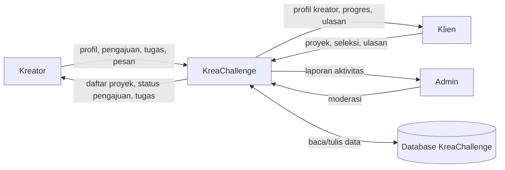
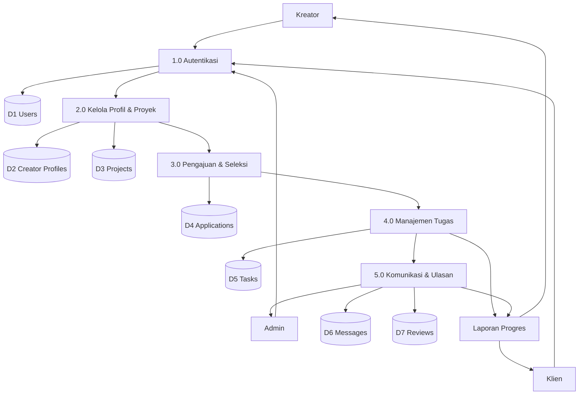

# Data Flow Diagram (DFD)

## 1. Tujuan

DFD menggambarkan aliran data dalam sistem KreaChallenge, mulai dari entitas eksternal, proses, penyimpanan data, hingga keluaran yang diterima pengguna. Dokumen ini menggunakan dua level: Level 0 (gambaran umum) dan Level 1 (proses utama).

## 2. Entitas Eksternal

| Entitas | Peran |
|---|---|
| Kreator | Mengirim profil, pengajuan, tugas, pesan; menerima info proyek |
| Klien | Mengirim proyek, seleksi, ulasan; menerima info kreator dan progres |
| Admin | Mengirim aksi moderasi; menerima laporan aktivitas |

## 3. DFD Level 0 (Context Diagram)

## 4. DFD Level 1

## 5. Deskripsi Proses

| No | Proses | Input | Output | Penyimpanan |
|---|---|---|---|---|
| 1.0 | Autentikasi | Email, password | Sesi pengguna | D1 Users |
| 2.0 | Kelola Profil & Proyek | Data profil, brief proyek | Profil & proyek tersimpan | D2, D3 |
| 3.0 | Pengajuan & Seleksi | Pesan pengajuan, keputusan klien | Status pengajuan | D4 |
| 4.0 | Manajemen Tugas | Judul tugas, penanggung jawab | Daftar tugas & progres | D5 |
| 5.0 | Komunikasi & Ulasan | Pesan, rating, komentar | Riwayat chat & ulasan | D6, D7 |

## 6. Deskripsi Data Store

| Kode | Nama | Isi |
|---|---|---|
| D1 | Users | Akun, peran, kredensial |
| D2 | Creator Profiles | Bio, keahlian, portofolio |
| D3 | Projects | Judul, brief, tenggat, anggaran, status |
| D4 | Applications | Pengajuan dan statusnya |
| D5 | Tasks | Tugas, penanggung jawab, status |
| D6 | Messages | Pesan per proyek |
| D7 | Reviews | Rating dan komentar |

## 7. Aliran Data Penting

1. **Aliran Registrasi:** Pengguna → 1.0 → D1.
2. **Aliran Proyek:** Klien → 2.0 → D3 → Kreator.
3. **Aliran Pengajuan:** Kreator → 3.0 → D4 → Klien.
4. **Aliran Tugas:** Klien/Kreator → 4.0 → D5 → Laporan Progres.
5. **Aliran Ulasan:** Klien → 5.0 → D7 → Profil Kreator.

## 8. Kesimpulan

DFD Level 0 menunjukkan KreaChallenge sebagai satu sistem utama yang berinteraksi dengan tiga entitas eksternal. DFD Level 1 memecah sistem menjadi lima proses utama dan tujuh penyimpanan data yang selaras dengan ERD.
