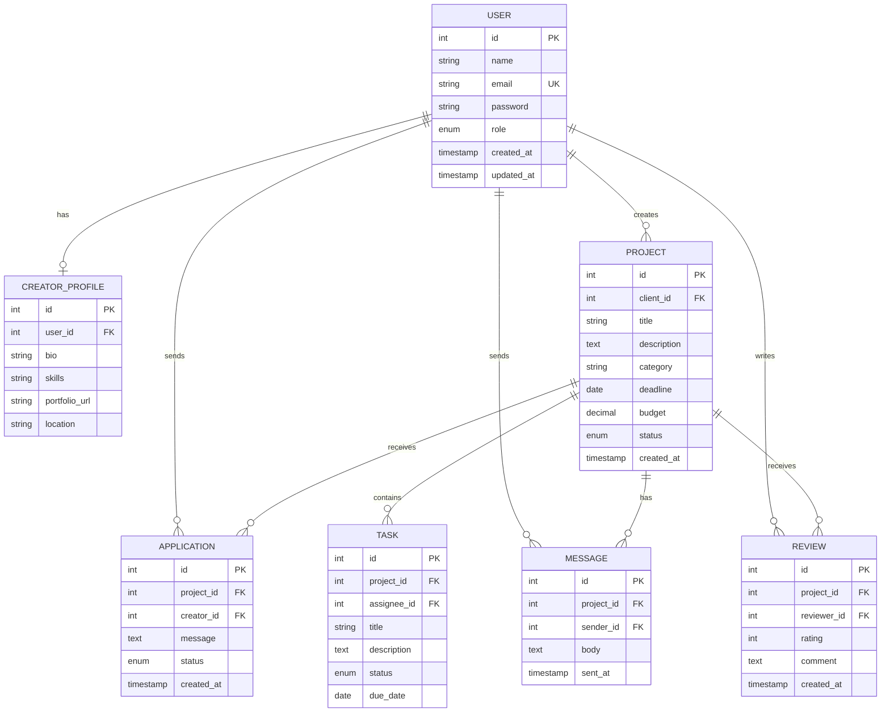

# Entity Relationship Diagram (ERD)

## 1. Tujuan

ERD menggambarkan struktur data KreaChallenge beserta hubungan antarentitas. Dokumen ini menjadi acuan dalam pembuatan migrasi database dan model Eloquent pada Laravel.

## 2. Daftar Entitas

| Entitas | Keterangan |
|---|---|
| USER | Data akun pengguna (kreator, klien, admin) |
| CREATOR_PROFILE | Detail profil dan portofolio kreator |
| PROJECT | Data proyek kreatif |
| APPLICATION | Pengajuan kreator terhadap proyek |
| TASK | Tugas dalam proyek |
| MESSAGE | Pesan komunikasi proyek |
| REVIEW | Ulasan hasil proyek |

## 3. Diagram ERD

## 4. Kardinalitas

| Hubungan | Kardinalitas | Penjelasan |
|---|---|---|
| USER → CREATOR_PROFILE | 1 : 0..1 | Satu pengguna maksimal satu profil kreator |
| USER → PROJECT | 1 : 0..* | Satu klien dapat membuat banyak proyek |
| USER → APPLICATION | 1 : 0..* | Satu kreator dapat mengirim banyak pengajuan |
| PROJECT → APPLICATION | 1 : 0..* | Satu proyek menerima banyak pengajuan |
| PROJECT → TASK | 1 : 0..* | Satu proyek memiliki banyak tugas |
| PROJECT → MESSAGE | 1 : 0..* | Satu proyek memiliki banyak pesan |
| PROJECT → REVIEW | 1 : 0..1 | Satu proyek maksimal satu ulasan final |

## 5. Kamus Data Ringkas

### Tabel `users`

| Field | Tipe | Keterangan |
|---|---|---|
| id | bigint PK | Identitas pengguna |
| name | varchar | Nama lengkap |
| email | varchar UK | Email unik untuk login |
| password | varchar | Password hasil hash |
| role | enum | `creator`, `client`, `admin` |

### Tabel `projects`

| Field | Tipe | Keterangan |
|---|---|---|
| id | bigint PK | Identitas proyek |
| client_id | bigint FK | Pemilik proyek |
| title | varchar | Judul proyek |
| description | text | Brief proyek |
| category | varchar | Kategori keahlian |
| deadline | date | Batas waktu |
| budget | decimal | Anggaran |
| status | enum | `open`, `in_progress`, `completed`, `cancelled` |

### Tabel `applications`

| Field | Tipe | Keterangan |
|---|---|---|
| status | enum | `pending`, `accepted`, `rejected` |

### Tabel `tasks`

| Field | Tipe | Keterangan |
|---|---|---|
| status | enum | `todo`, `in_progress`, `done` |

## 6. Pertimbangan Desain

1. `applications` memiliki constraint unik pada pasangan `(project_id, creator_id)` untuk mencegah pengajuan ganda.
2. `tasks.assignee_id` dapat bernilai null sebelum ditugaskan.
3. `reviews` dibatasi satu baris per proyek agar penilaian tetap ringkas.
4. Indeks ditambahkan pada `projects.category`, `applications.status`, dan `tasks.status` untuk mempercepat pencarian.

## 7. Kesimpulan

ERD KreaChallenge terdiri dari tujuh entitas dengan hubungan yang jelas dan mendukung seluruh kebutuhan fungsional. Skema ini diimplementasikan pada file `04_Pengembangan_Aplikasi/database.md`.
