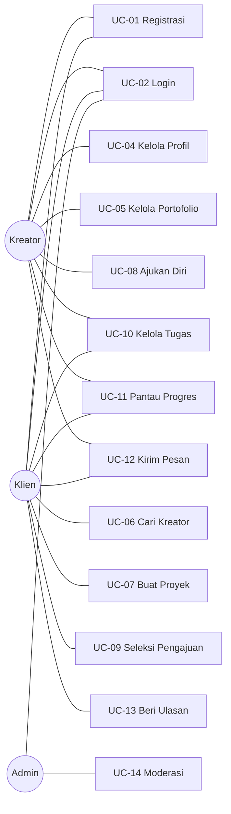

# Use Case

## 1. Tujuan

Dokumen ini menggambarkan interaksi antara pengguna (aktor) dengan sistem KreaChallenge. Use case membantu memetakan fitur dari sudut pandang pengguna sebelum dibuat desain antarmuka dan implementasi.

## 2. Aktor

| Aktor | Deskripsi |
|---|---|
| Kreator | Pengguna yang menawarkan keahlian dan dapat mengajukan diri ke proyek |
| Klien | Pengguna yang membuat proyek dan memilih kreator |
| Admin | Pengguna yang mengelola pengguna dan moderasi konten |
| Sistem | Pihak internal yang memproses data dan validasi |

## 3. Daftar Use Case

| ID | Nama Use Case | Aktor Utama | Deskripsi Singkat |
|---|---|---|---|
| UC-01 | Registrasi | Kreator, Klien | Membuat akun baru |
| UC-02 | Login | Semua | Masuk ke sistem |
| UC-03 | Logout | Semua | Keluar dari sistem |
| UC-04 | Kelola Profil | Kreator, Klien | Memperbarui data profil |
| UC-05 | Kelola Portofolio | Kreator | Menambahkan karya dan keahlian |
| UC-06 | Cari Kreator | Klien | Mencari kreator berdasarkan keahlian |
| UC-07 | Buat Proyek | Klien | Membuat proyek baru |
| UC-08 | Ajukan Diri | Kreator | Mengajukan partisipasi ke proyek |
| UC-09 | Seleksi Pengajuan | Klien | Menerima atau menolak pengajuan |
| UC-10 | Kelola Tugas | Klien, Kreator | Membuat dan memperbarui tugas |
| UC-11 | Pantau Progres | Klien, Kreator | Melihat persentase penyelesaian proyek |
| UC-12 | Kirim Pesan | Klien, Kreator | Berkomunikasi dalam proyek |
| UC-13 | Beri Ulasan | Klien | Memberi rating setelah proyek selesai |
| UC-14 | Moderasi | Admin | Menonaktifkan akun atau proyek |

## 4. Diagram Use Case

## 5. Spesifikasi Use Case Prioritas

### UC-08 Ajukan Diri

| Item | Keterangan |
|---|---|
| Aktor | Kreator |
| Prekondisi | Kreator sudah login dan profil lengkap |
| Postkondisi | Tersimpan pengajuan dengan status `pending` |
| Alur Utama | 1. Kreator membuka detail proyek 2. Kreator mengisi pesan pengajuan 3. Kreator menekan tombol Ajukan 4. Sistem menyimpan pengajuan 5. Sistem menampilkan notifikasi berhasil |
| Alur Alternatif | Jika profil belum lengkap, sistem meminta kreator melengkapi profil terlebih dahulu |
| Eksepsi | Jika kreator sudah pernah mengajukan ke proyek yang sama, sistem menolak pengajuan duplikat |

### UC-09 Seleksi Pengajuan

| Item | Keterangan |
|---|---|
| Aktor | Klien |
| Prekondisi | Klien adalah pemilik proyek dan terdapat pengajuan |
| Postkondisi | Status pengajuan berubah menjadi `accepted` atau `rejected` |
| Alur Utama | 1. Klien membuka daftar pengajuan 2. Klien memilih satu pengajuan 3. Klien menekan Terima atau Tolak 4. Sistem memperbarui status 5. Jika diterima, kreator ditambahkan ke tim proyek |
| Eksepsi | Jika proyek sudah selesai, tombol seleksi dinonaktifkan |

## 6. Hubungan Use Case

- UC-01 dan UC-02 merupakan prasyarat bagi seluruh use case lain.
- UC-08 bergantung pada UC-05 (profil kreator lengkap).
- UC-10 dan UC-11 bergantung pada UC-09 (tim terbentuk).
- UC-13 hanya tersedia setelah UC-11 menunjukkan proyek selesai.

## 7. Kesimpulan

Use case KreaChallenge mencakup 14 interaksi utama yang melibatkan tiga aktor. Pemodelan ini menjadi dasar bagi activity diagram dan pengujian black box.
