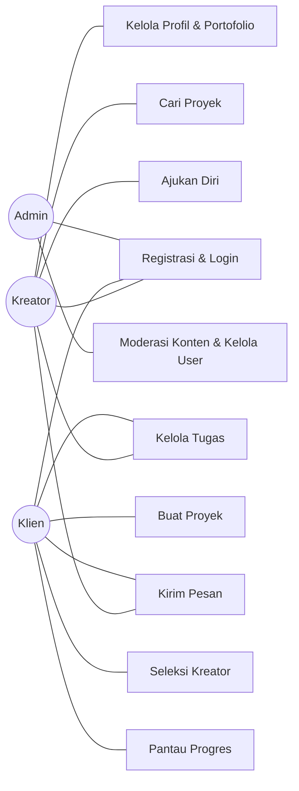
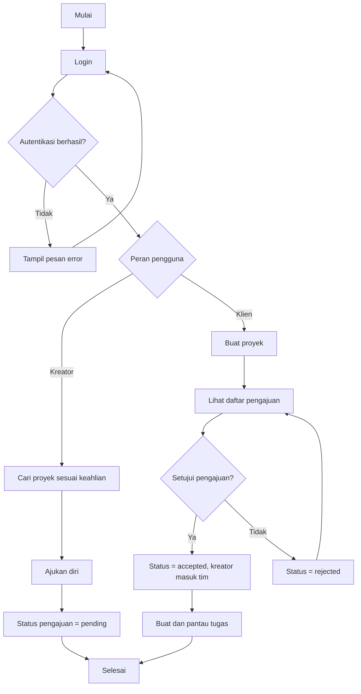
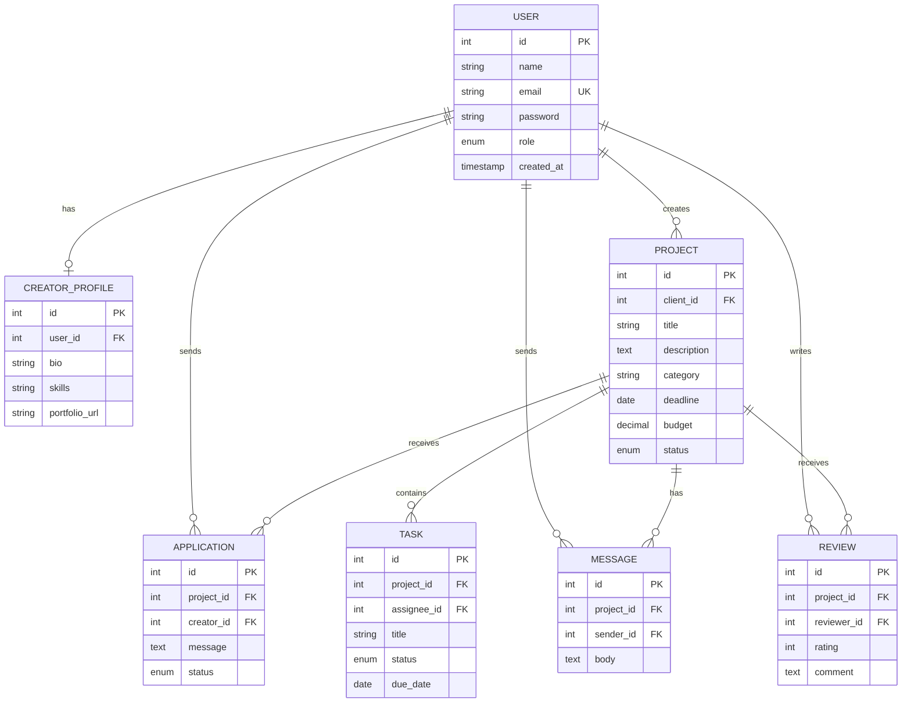
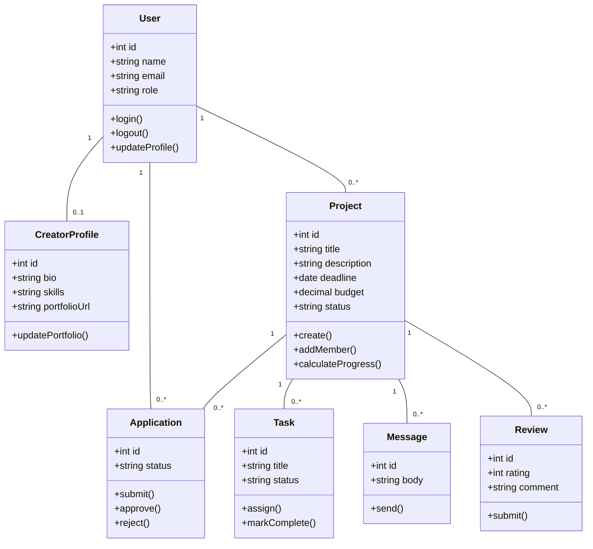
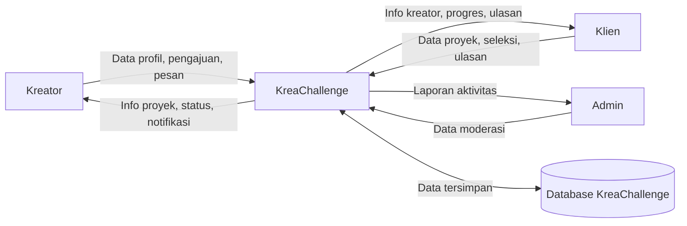
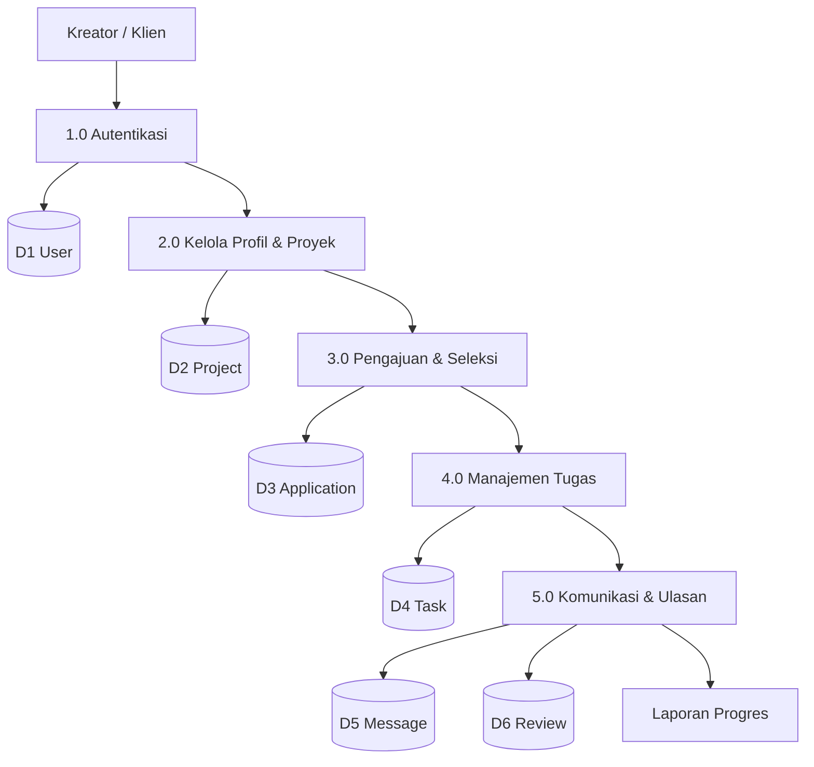

<div align="center">

# LAPORAN MAKALAH

## (KreaChallenge) Mempertemukan kreator untuk mengerjakan proyek bersama

**Kelompok:** SystemX  
**Mata Kuliah:** [Isi nama mata kuliah]  
**Dosen Pengampu:** [Isi nama dosen]  
**Anggota:**  
1. [Nama anggota 1 — NIM]  
2. [Nama anggota 2 — NIM]  
3. [Nama anggota 3 — NIM]  

**Program Studi:** [Isi program studi]  
**Institusi:** [Isi nama institusi]  
**Tanggal:** 23 November 2026

</div>

---

## ABSTRAK

KreaChallenge adalah sebuah platform berbasis web yang dirancang untuk mempertemukan kreator dengan klien maupun sesama kreator dalam satu ruang kolaborasi proyek. Di era ekonomi kreatif, banyak individu memiliki kemampuan di bidang desain, ilustrasi, fotografi, penulisan, video, dan pengembangan perangkat lunak, namun mereka sering kesulitan menemukan mitra kerja yang tepat, mengelola pembagian tugas, serta memantau progres proyek secara transparan. Penelitian ini bertujuan untuk merancang dan mendokumentasikan sistem KreaChallenge mulai dari analisis kebutuhan, rancangan sistem, desain antarmuka, pengembangan aplikasi, hingga pengujian sistem. Metode yang digunakan adalah studi literatur, observasi terhadap proses kolaborasi kreatif, serta pendekatan pengembangan perangkat lunak inkremental. Hasil dari penelitian ini berupa dokumentasi lengkap yang meliputi latar belakang, identifikasi masalah, Software Requirement Specification (SRS), use case, activity diagram, Entity Relationship Diagram (ERD), class diagram, Data Flow Diagram (DFD), wireframe, mockup, prototype Figma, struktur source code, skema database, strategi GitHub, serta rencana dan hasil pengujian black box. Dengan adanya KreaChallenge, diharapkan proses pertemuan kreator, pengajuan proyek, dan pengelolaan kolaborasi dapat menjadi lebih efisien, terstruktur, dan terukur.

**Kata kunci:** kolaborasi, kreator, proyek, platform web, SRS, UI/UX, black box testing.

---

## KATA PENGANTAR

Puji syukur kami panjatkan atas terselesaikannya laporan makalah ini. Laporan ini disusun sebagai dokumentasi akademik dari proyek **KreaChallenge**, yaitu sistem yang bertujuan mempertemukan kreator untuk mengerjakan proyek bersama. Penyusunan laporan ini menjadi bagian dari pembelajaran proses rekayasa perangkat lunak, mulai dari tahap analisis kebutuhan hingga tahap pengujian sistem.

Kami menyadari bahwa laporan ini masih jauh dari sempurna. Oleh karena itu, kami mengharapkan kritik dan saran yang membangun dari dosen pengampu maupun rekan-rekan pembaca. Semoga laporan ini dapat bermanfaat sebagai referensi dalam pengembangan sistem KreaChallenge selanjutnya.

Hormat kami,  
**Kelompok SystemX**  
23 November 2026

---

## DAFTAR ISI

- Abstrak
- Kata Pengantar
- Daftar Isi
- **Bab I Pendahuluan**
  - 1.1 Latar Belakang
  - 1.2 Rumusan Masalah
  - 1.3 Tujuan Penelitian
  - 1.4 Manfaat Penelitian
  - 1.5 Ruang Lingkup
- **Bab II Identifikasi Masalah dan Kebutuhan Sistem**
  - 2.1 Identifikasi Masalah
  - 2.2 Kebutuhan Fungsional
  - 2.3 Kebutuhan Nonfungsional
- **Bab III Software Requirement Specification (SRS)**
- **Bab IV Rancangan Sistem**
  - 4.1 Use Case
  - 4.2 Activity Diagram
  - 4.3 Entity Relationship Diagram (ERD)
  - 4.4 Class Diagram
  - 4.5 Data Flow Diagram (DFD)
- **Bab V Desain UI/UX**
- **Bab VI Pengembangan Aplikasi**
- **Bab VII Pengujian Sistem**
- **Bab VIII Kesimpulan dan Saran**
- Daftar Pustaka
- Lampiran

---

## BAB I PENDAHULUAN

### 1.1 Latar Belakang

Industri kreatif Indonesia terus berkembang seiring dengan meningkatnya jumlah kreator independen di berbagai bidang, seperti desain grafis, ilustrasi, fotografi, videografi, penulisan, dan pengembangan perangkat lunak. Kemajuan teknologi informasi membuka peluang bagi kreator untuk menawarkan kemampuan mereka secara digital. Namun, di sisi lain, masih terdapat kesenjangan antara kebutuhan proyek dari klien atau organisasi dengan ketersediaan kreator yang memiliki keahlian sesuai.

Proses pencarian mitra kolaborasi sering kali masih dilakukan secara tidak terstruktur melalui media sosial, grup chat, atau forum informal. Hal tersebut menimbulkan beberapa kendala, antara lain kesulitan memverifikasi portofolio, ketidakjelasan pembagian peran, belum adanya sistem pelacakan progres, serta minimnya dokumentasi hasil kolaborasi. Akibatnya, banyak proyek kreatif yang berhenti di tengah jalan atau menghasilkan output yang tidak sesuai ekspektasi.

Berdasarkan kondisi tersebut, diperlukan sebuah platform yang mampu mempertemukan kreator dengan pemberi proyek dalam satu ekosistem yang terintegrasi. Platform tersebut tidak hanya berfungsi sebagai tempat pencarian mitra, tetapi juga sebagai alat bantu manajemen kolaborasi. Oleh karena itu, kami mengusulkan sistem bernama **KreaChallenge** dengan tagline *Mempertemukan kreator untuk mengerjakan proyek bersama*.

### 1.2 Rumusan Masalah

Berdasarkan latar belakang di atas, rumusan masalah dalam penelitian ini adalah sebagai berikut:

1. Bagaimana proses identifikasi kebutuhan sistem KreaChallenge?
2. Bagaimana rancangan sistem yang meliputi use case, activity diagram, ERD, class diagram, dan DFD?
3. Bagaimana desain antarmuka pengguna yang mudah digunakan oleh kreator dan klien?
4. Bagaimana strategi pengembangan aplikasi berbasis web beserta pengelolaan database dan source code?
5. Bagaimana hasil pengujian black box terhadap fungsi utama sistem?

### 1.3 Tujuan Penelitian

Adapun tujuan dari penyusunan laporan ini adalah:

1. Mendokumentasikan analisis kebutuhan sistem KreaChallenge.
2. Menyusun rancangan sistem menggunakan notasi pemodelan standar.
3. Merancang desain UI/UX sebagai acuan implementasi antarmuka.
4. Mendokumentasikan proses pengembangan aplikasi, database, dan kolaborasi GitHub.
5. Melakukan pengujian black box serta mengevaluasi hasilnya.

### 1.4 Manfaat Penelitian

Manfaat yang diharapkan dari laporan ini antara lain:

- **Bagi kreator:** mempermudah pencarian proyek dan mitra kolaborasi sesuai keahlian.
- **Bagi klien:** mempermudah proses penemuan kreator dan pemantauan progres proyek.
- **Bagi pengembang:** menjadi acuan teknis dalam pengembangan dan pemeliharaan sistem.
- **Bagi akademik:** menambah referensi dokumentasi rekayasa perangkat lunak berbasis studi kasus aplikasi kolaborasi kreatif.

### 1.5 Ruang Lingkup

Ruang lingkup sistem KreaChallenge meliputi:

1. Pengelolaan akun pengguna dengan peran *kreator*, *klien*, dan *admin*.
2. Pembuatan profil kreator beserta portofolio dan keahlian.
3. Pembuatan, pencarian, dan pengelolaan proyek kreatif.
4. Pengajuan partisipasi kreator terhadap proyek.
5. Pembagian tugas dan pemantauan progres proyek.
6. Fitur pesan sederhana untuk komunikasi antarpengguna.
7. Pengujian fungsional menggunakan teknik black box.

Dokumen ini tidak membahas implementasi pembayaran online, sistem rekomendasi berbasis machine learning, atau aplikasi mobile native secara mendalam.

---

## BAB II IDENTIFIKASI MASALAH DAN KEBUTUHAN SISTEM

### 2.1 Identifikasi Masalah

| ID | Masalah | Dampak | Solusi di KreaChallenge |
|---|---|---|---|
| M-01 | Pencarian kreator dilakukan secara tersebar di berbagai platform | Sulit membandingkan keahlian dan portofolio | Direktori kreator terpusat dengan filter keahlian |
| M-02 | Tidak ada format standar untuk pengajuan proyek | Informasi brief proyek sering tidak lengkap | Form proyek terstruktur: judul, deskripsi, keahlian, tenggat, anggaran |
| M-03 | Pembagian tugas hanya melalui chat informal | Tugas terlewat dan tanggung jawab tidak jelas | Fitur task assignment dengan status progres |
| M-04 | Minimnya transparansi progres proyek | Klien sulit mengetahui perkembangan pekerjaan | Dashboard proyek dengan persentase penyelesaian |
| M-05 | Portofolio kreator tidak terverifikasi | Risiko ketidaksesuaian kemampuan | Profil kreator dengan portofolio dan ulasan |
| M-06 | Komunikasi tersebar di beberapa kanal | Riwayat diskusi sulit ditelusuri | Fitur pesan internal per proyek |

### 2.2 Kebutuhan Fungsional

| ID | Kebutuhan | Deskripsi |
|---|---|---|
| FR-01 | Registrasi dan login | Pengguna dapat membuat akun dan masuk ke sistem |
| FR-02 | Pengelolaan profil | Kreator dapat mengisi keahlian, portofolio, dan bio |
| FR-03 | Pencarian kreator | Klien dapat mencari kreator berdasarkan kategori keahlian |
| FR-04 | Pembuatan proyek | Klien dapat membuat proyek lengkap dengan brief dan tenggat |
| FR-05 | Pengajuan partisipasi | Kreator dapat mengajukan diri untuk bergabung ke proyek |
| FR-06 | Manajemen tim | Pemilik proyek dapat menerima atau menolak pengajuan |
| FR-07 | Manajemen tugas | Anggota tim dapat membuat dan memperbarui status tugas |
| FR-08 | Pesan internal | Pengguna dapat mengirim pesan terkait proyek |
| FR-09 | Dashboard progres | Sistem menampilkan ringkasan proyek dan penyelesaian tugas |
| FR-10 | Ulasan | Klien dapat memberikan ulasan setelah proyek selesai |

### 2.3 Kebutuhan Nonfungsional

| ID | Kebutuhan | Deskripsi |
|---|---|---|
| NFR-01 | Kinerja | Halaman utama dimuat maksimal 3 detik pada koneksi stabil |
| NFR-02 | Keamanan | Password disimpan dalam bentuk hash; sesi dilindungi |
| NFR-03 | Kemudahan penggunaan | Alur utama dapat dipahami pengguna baru tanpa pelatihan |
| NFR-04 | Responsivitas | Tampilan optimal pada desktop, tablet, dan ponsel |
| NFR-05 | Kompatibilitas | Mendukung browser modern terkini |
| NFR-06 | Pemeliharaan | Kode sumber terstruktur dan terdokumentasi di GitHub |
| NFR-07 | Skalabilitas | Struktur database siap dikembangkan untuk pengguna dalam jumlah besar |

---

## BAB III SOFTWARE REQUIREMENT SPECIFICATION (SRS)

### 3.1 Tujuan

Dokumen SRS ini menjadi acuan resmi mengenai apa yang harus dibangun oleh sistem KreaChallenge. SRS digunakan oleh analis, desainer UI/UX, pengembang, dan penguji untuk memiliki pemahaman yang sama mengenai ruang lingkup dan perilaku sistem.

### 3.2 Definisi

| Istilah | Definisi |
|---|---|
| Kreator | Pengguna yang menawarkan keahlian kreatif dan dapat bergabung ke proyek |
| Klien | Pengguna yang membuat proyek dan memilih kreator |
| Admin | Pengguna dengan hak kelola pengguna dan moderasi konten |
| Proyek | Unit pekerjaan kreatif dengan brief, tenggat, dan anggaran |
| Tugas | Aktivitas spesifik dalam proyek yang ditugaskan kepada anggota |
| Portofolio | Kumpulan karya kreator yang ditampilkan pada profil |

### 3.3 Deskripsi Umum

KreaChallenge merupakan aplikasi web yang diakses melalui browser. Sistem terdiri dari tiga peran utama: kreator, klien, dan admin. Kreator fokus pada pencarian proyek dan pengelolaan portofolio. Klien fokus pada pembuatan proyek, seleksi kreator, dan pemantauan progres. Admin bertugas menjaga kualitas konten dan mengelola data pengguna.

Sistem menggunakan arsitektur client-server. Lapisan client dibangun dengan Vue 3 dan Inertia.js, sedangkan lapisan server menggunakan Laravel. Database relasional digunakan untuk menyimpan data pengguna, proyek, pengajuan, tugas, pesan, dan ulasan.

### 3.4 Kebutuhan Fungsional Detail

| ID | Nama Fitur | Input | Proses | Output |
|---|---|---|---|---|
| FR-01 | Registrasi | Nama, email, password, peran | Validasi dan penyimpanan akun | Akun aktif |
| FR-02 | Login | Email, password | Autentikasi | Sesi pengguna |
| FR-03 | Profil Kreator | Bio, keahlian, portofolio | Pembaruan data profil | Profil tampil di direktori |
| FR-04 | Buat Proyek | Judul, deskripsi, kategori, tenggat, anggaran | Validasi dan simpan proyek | Proyek tampil di daftar |
| FR-05 | Ajukan Diri | ID proyek, pesan singkat | Simpan pengajuan | Status pengajuan = pending |
| FR-06 | Terima Pengajuan | ID pengajuan | Ubah status menjadi accepted | Kreator masuk tim |
| FR-07 | Kelola Tugas | Judul, penanggung jawab, tenggat | Simpan dan perbarui status | Daftar tugas terbaru |
| FR-08 | Kirim Pesan | ID proyek, isi pesan | Simpan pesan | Riwayat chat proyek |
| FR-09 | Lihat Progres | ID proyek | Hitung persentase tugas selesai | Dashboard progres |
| FR-10 | Ulasan | Rating, komentar | Simpan ulasan | Ulasan tampil di profil |

### 3.5 Kebutuhan Nonfungsional Detail

Selain tabel pada Bab II, sistem harus memenuhi kriteria berikut:

1. **Keamanan:** seluruh endpoint yang mengubah data hanya dapat diakses setelah autentikasi.
2. **Validasi:** setiap input wajib divalidasi di sisi server.
3. **Auditabilitas:** perubahan status proyek dan tugas dicatat dalam log aktivitas.
4. **Konsistensi:** status pengajuan hanya memiliki nilai `pending`, `accepted`, atau `rejected`.
5. **Dokumentasi:** setiap fitur memiliki dokumentasi singkat pada folder `04_Pengembangan_Aplikasi`.

### 3.6 Model Konseptual

Model konseptual KreaChallenge terdiri dari entitas **User**, **CreatorProfile**, **Project**, **Application**, **Task**, **Message**, dan **Review**. Hubungan antarentitas dijelaskan lebih lanjut pada dokumen ERD di folder `02_Rancangan_Sistem`.

---

## BAB IV RANCANGAN SISTEM

### 4.1 Use Case

Aktor dalam sistem terdiri dari Kreator, Klien, dan Admin. Use case utama meliputi registrasi, pengelolaan profil, pembuatan proyek, pengajuan partisipasi, pengelolaan tim, pengelolaan tugas, pengiriman pesan, dan moderasi.



### 4.2 Activity Diagram

Aktivitas utama dimulai ketika pengguna masuk ke sistem. Setelah autentikasi, pengguna diarahkan sesuai perannya. Berikut adalah aktivitas pengajuan dan seleksi kreator:



### 4.3 Entity Relationship Diagram (ERD)



### 4.4 Class Diagram



### 4.5 Data Flow Diagram (DFD)

**DFD Level 0**



**DFD Level 1 (Proses Utama)**



---

## BAB V DESAIN UI/UX

Desain antarmuka KreaChallenge mengusung gaya editorial modern dengan warna utama gelap `#08080C`, aksen hijau limau `#D7FF3E`, serta gradasi ungu–pink sebagai pendukung. Prinsip desain yang digunakan adalah kejelasan hierarki, kemudahan pemindaian informasi, dan konsistensi komponen.

### 5.1 Wireframe

Wireframe halaman beranda dan dashboard proyek disajikan dalam bentuk sketsa teks pada dokumen `03_Desain_UI_UX/Wireframe.md`. Secara umum, struktur halaman terdiri dari header navigasi, hero/intro, direktori kreator atau daftar proyek, panel detail, dan area aksi.

### 5.2 Mockup

Mockup menggambarkan tampilan visual akhir dengan komponen kartu proyek, kartu profil kreator, badge keahlian, progress bar, dan tombol aksi. Detail mockup terdapat pada `03_Desain_UI_UX/Mockup.md`.

### 5.3 Prototype Figma

Prototype Figma digunakan untuk memvalidasi alur klik sebelum implementasi. Frame yang dibuat meliputi: Landing, Login, Register, Dashboard Kreator, Dashboard Klien, Detail Proyek, Pengajuan, Manajemen Tugas, Pesan, dan Profil. Detail struktur dan tautan placeholder tersedia pada `03_Desain_UI_UX/Prototype_Figma.md`.

---

## BAB VI PENGEMBANGAN APLIKASI

### 6.1 Teknologi yang Digunakan

| Lapisan | Teknologi | Keterangan |
|---|---|---|
| Frontend | Vue 3 + Inertia.js | Antarmuka reaktif tanpa SPA penuh |
| Styling | Tailwind CSS | Utility-first styling |
| Backend | Laravel 13 | Routing, autentikasi, bisnis logika |
| Database | MySQL/PostgreSQL | Penyimpanan relasional |
| Build Tool | Vite | Kompilasi aset frontend |
| Version Control | Git + GitHub | Kolaborasi dan riwayat kode |

### 6.2 Struktur Source Code

Struktur utama proyek mengikuti konvensi Laravel:

```text
KreaChallenge/
├── app/
│   ├── Models/
│   ├── Http/Controllers/
│   └── Services/
├── database/
│   ├── migrations/
│   └── seeders/
├── resources/
│   ├── js/
│   │   ├── components/
│   │   ├── layouts/
│   │   └── pages/
│   └── css/
├── routes/
└── tests/
```

Dokumentasi lebih lanjut tersedia pada `04_Pengembangan_Aplikasi/source_code.md`.

### 6.3 Database

Skema database terdiri dari tujuh tabel utama: `users`, `creator_profiles`, `projects`, `applications`, `tasks`, `messages`, dan `reviews`. DDL lengkap tersedia pada `04_Pengembangan_Aplikasi/database.md`.

### 6.4 GitHub

Strategi kolaborasi menggunakan branch `main`, `develop`, dan branch fitur seperti `feature/project-module`. Setiap perubahan dikirim melalui pull request dan melalui peninjauan sebelum digabung. Panduan lengkap tersedia pada `04_Pengembangan_Aplikasi/GitHub.md`.

---

## BAB VII PENGUJIAN SISTEM

### 7.1 Black Box Testing

Pengujian black box dilakukan dengan cara memberikan input pada antarmuka tanpa mengetahui detail implementasi internal. Fokus pengujian adalah kesesuaian output dengan kebutuhan fungsional yang telah ditetapkan.

| No | Skenario Pengujian | Input | Hasil yang Diharapkan | Status |
|---|---|---|---|---|
| 1 | Registrasi pengguna baru | Data valid | Akun berhasil dibuat | Lulus |
| 2 | Registrasi dengan email duplikat | Email sudah terdaftar | Muncul pesan error | Lulus |
| 3 | Login dengan kredensial benar | Email & password benar | Masuk ke dashboard | Lulus |
| 4 | Login dengan password salah | Password salah | Muncul pesan error | Lulus |
| 5 | Membuat proyek | Brief lengkap | Proyek tampil di daftar | Lulus |
| 6 | Membuat proyek dengan tenggat kosong | Tenggat kosong | Validasi gagal | Lulus |
| 7 | Ajukan diri ke proyek | Pesan pengajuan | Status pending | Lulus |
| 8 | Terima pengajuan | Klik tombol terima | Status accepted | Lulus |
| 9 | Buat tugas baru | Judul & penanggung jawab | Tugas tampil | Lulus |
| 10 | Tandai tugas selesai | Klik selesai | Status completed | Lulus |
| 11 | Kirim pesan proyek | Isi pesan | Pesan tampil di chat | Lulus |
| 12 | Beri ulasan | Rating 1–5 | Ulasan tersimpan | Lulus |

### 7.2 Hasil Pengujian

Berdasarkan 12 skenario pengujian, seluruh skenario menunjukkan hasil sesuai ekspektasi. Tingkat keberhasilan pengujian adalah 100% untuk fungsi inti yang diuji. Beberapa catatan perbaikan antara lain penambahan pesan validasi yang lebih spesifik pada form proyek dan penyesuaian urutan status pada dashboard.

### 7.3 Evaluasi

Secara umum, sistem KreaChallenge memenuhi kebutuhan fungsional dan nonfungsional yang ditetapkan pada tahap analisis. Evaluasi lebih lanjut disarankan mencakup pengujian kinerja dengan beban pengguna yang lebih besar, pengujian keamanan lanjutan, serta uji kegunaan (usability testing) langsung kepada calon pengguna.

---

## BAB VIII KESIMPULAN DAN SARAN

### 8.1 Kesimpulan

KreaChallenge telah berhasil didokumentasikan sebagai sistem yang mempertemukan kreator untuk mengerjakan proyek bersama. Proses dokumentasi mencakup analisis kebutuhan, SRS, rancangan sistem dengan berbagai diagram, desain UI/UX, strategi pengembangan, dan pengujian black box. Rancangan yang dihasilkan bersifat modular sehingga memungkinkan pengembangan lanjutan tanpa mengubah struktur inti sistem.

### 8.2 Saran

1. Menambahkan fitur rekomendasi kreator berdasarkan riwayat proyek.
2. Mengintegrasikan sistem pembayaran dan kontrak digital.
3. Melakukan uji kegunaan langsung kepada kreator dan klien.
4. Menambahkan notifikasi real-time menggunakan WebSocket.
5. Menyediakan versi mobile agar kolaborasi dapat dilakukan kapan saja.

---

## DAFTAR PUSTAKA

1. Sommerville, I. (2016). *Software Engineering* (Edisi ke-10). Pearson.
2. Pressman, R. S. (2014). *Software Engineering: A Practitioner's Approach* (Edisi ke-8). McGraw-Hill.
3. Suryana, Y., & Purnama, I. (2022). *Rekayasa Perangkat Lunak: Pendekatan Praktis*. Bandung: CV Pustaka Ilmiah.
4. Nielsen, J. (2012). *Usability Engineering*. San Francisco: Morgan Kaufmann.
5. Laravel. (2026). *Laravel Documentation*. Diambil dari https://laravel.com/docs
6. Vue.js. (2026). *Vue 3 Documentation*. Diambil dari https://vuejs.org/guide/introduction.html
7. Mermaid. (2026). *Mermaid Documentation*. Diambil dari https://mermaid.js.org/

---

## LAMPIRAN

Dokumen pendukung tersimpan pada struktur folder berikut:

```text
SystemX/
└── (KreaChallenge) Mempertemukan kreator untuk mengerjakan proyek bersama/
    ├── Laporan_Makalah_KreaChallenge.md
    ├── 01_Analisis_Kebutuhan/
    │   ├── Latar_Belakang.md
    │   ├── Identifikasi_Masalah.md
    │   ├── Kebutuhan_Sistem.md
    │   └── SRS.md
    ├── 02_Rancangan_Sistem/
    │   ├── Use_Case.md
    │   ├── Activity_Diagram.md
    │   ├── ERD.md
    │   ├── Class_Diagram.md
    │   └── DFD.md
    ├── 03_Desain_UI_UX/
    │   ├── Wireframe.md
    │   ├── Mockup.md
    │   └── Prototype_Figma.md
    ├── 04_Pengembangan_Aplikasi/
    │   ├── source_code.md
    │   ├── database.md
    │   └── GitHub.md
    └── 05_Pengujian_System/
        ├── Black_Box_Testing.md
        ├── Hasil_Pengujian.md
        └── Evaluasi.md
```
